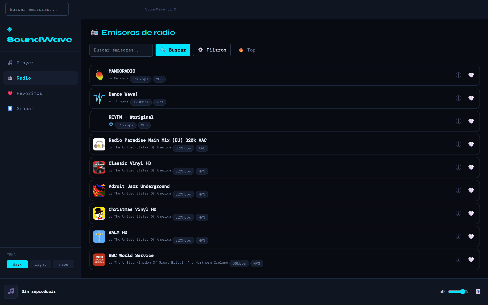
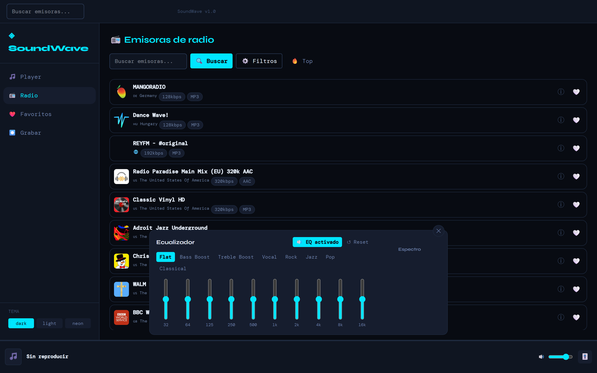
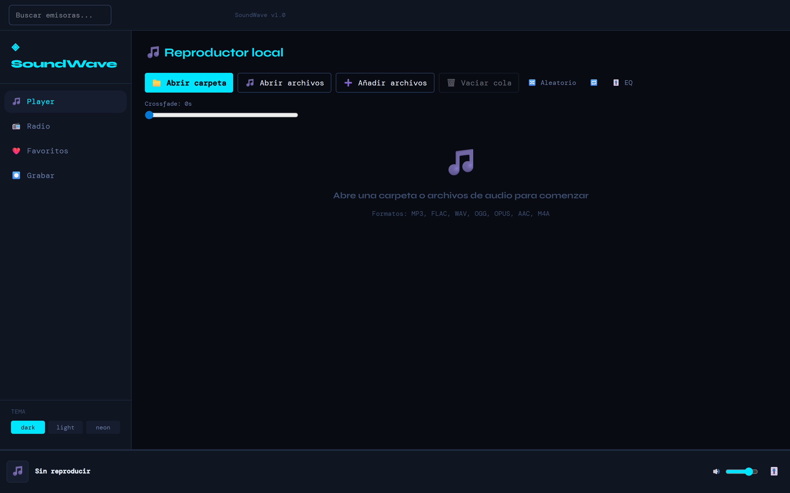
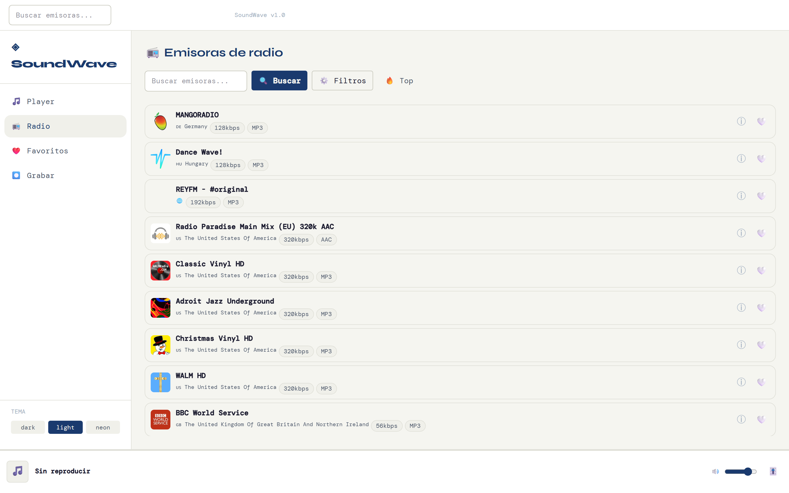
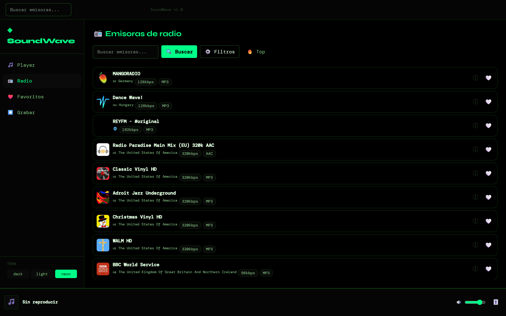
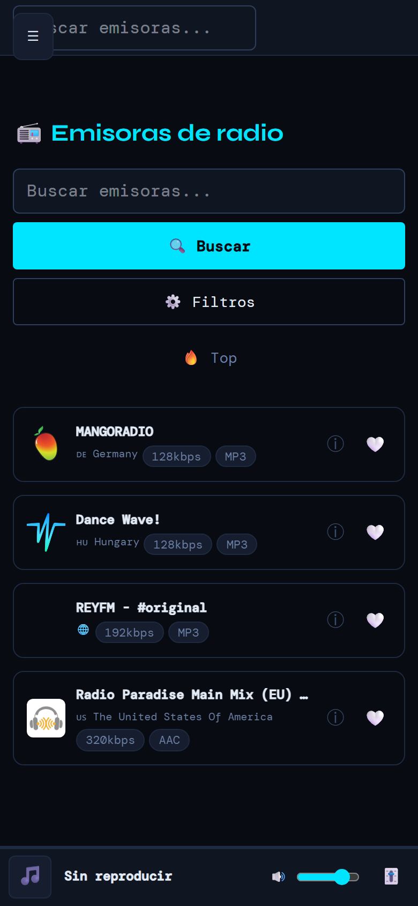

# SoundWave

🇪🇸 **[Leer en español → README.es.md](README.es.md)**

A modern, minimalist local music player and internet radio app.

**🎧 Live demo: [soundwave-woad.vercel.app](https://soundwave-woad.vercel.app)**




## Features

- **Local file player**: Play your music library with ID3 metadata, real shuffle and repeat (queue or track), crossfade, track filtering, and "Reopen last folder"
- **Internet radio**: Search and listen to stations worldwide via [radio-browser.info](https://www.radio-browser.info/), with HLS support and automatic reconnection
- **Global 10-band equalizer**: One panel accessible from any page (MiniPlayer, local player, or radio), with presets and bypass
- **Favorites system**: Save and export/import your favorite stations, with local and radio playback history (IndexedDB persistence)
- **Audio recorder**: Record "This tab", a browser tab, or a window, with real-time VU visualization — survives navigating to another page mid-recording
- **Audio visualizer**: Real-time audio spectrum with the Web Audio API
- **Keyboard shortcuts**: play/pause, tracks, volume, mute, equalizer — press `?` to see the full list
- **3 visual themes**: Dark (default), Light, and Neon
- **Installable PWA**: real icons (including a `maskable` one), works offline with a service worker and smart caching
- **Responsive design**: works on desktop, tablet, and mobile

## Screenshots

| | |
|---|---|
| **Equalizer**  | **Local player**  |
| **Dark theme**  | **Light theme**  |
| **Neon theme**  | **Mobile view**  |

## Tech Stack

| Category | Technologies |
|-----------|-------------|
| Framework | React 19 + TypeScript |
| Build | Vite 8 |
| Styling | TailwindCSS 4 + CSS Variables |
| State | Zustand |
| Router | React Router DOM 7 |
| Audio | native `<audio>` + hls.js + Web Audio API |
| DB | Dexie.js (IndexedDB) |
| Animation | Framer Motion |
| Tests | Vitest + Playwright |

## Quick Start

```bash
# Clone the repository
git clone https://github.com/sexwax/soundwave.git
cd soundwave

# Install dependencies
npm install

# Start the dev server
npm run dev
```

The app will be available at `http://localhost:5173`

## Deploying to Vercel

### Option 1: Automatic deploy (recommended)

1. Go to [vercel.com/new](https://vercel.com/new)
2. Import the `sexwax/soundwave` repository
3. Vercel will auto-detect it as a Vite project
4. Click **Deploy**

### Option 2: Deploy with the CLI

```bash
# Install the Vercel CLI
npm i -g vercel

# Log in
vercel login

# Deploy
vercel
```

### Automatic configuration

`vercel.json` is already set up with:

- Framework: Vite
- Build: `npm run build`
- Output: `dist/`
- Preview: `npm run preview`

### Environment Variables on Vercel

If you use the optional variables, configure them in Vercel:

1. Go to your project in Vercel
2. **Settings** → **Environment Variables**
3. Add:
   - `VITE_CORS_PROXY_URL`
   - `VITE_APP_URL`
4. Redeploy to apply the changes

## Available Commands

```bash
npm run dev          # Dev server with HMR
npm run build        # Build for production
npm run preview      # Preview the production build locally
npm run lint         # Run ESLint
npm test             # Unit tests (watch mode)
npm run test:ui      # Tests with a web UI
npm run test:e2e     # E2E tests with Playwright
npm run screenshots  # Regenerates docs/screenshots/*.png with Playwright (needs `npm i -D sharp` first — see CLAUDE.md)
```

## Environment Variables

Create a `.env` file based on `.env.example`:

```bash
VITE_CORS_PROXY_URL=https://your-proxy  # CORS proxy for streams (see "CORS Proxy" section)
VITE_APP_URL=https://your-domain.app    # Base URL for share links
```

All of them are optional — the app works without any configuration.

## CORS Proxy

Some radio stations don't send CORS headers, so the browser blocks their audio when the app tries to route it through the visualizer/equalizer (and in some cases, blocks playback entirely). `proxy/cloudflare-worker.js` is a Worker that forwards the stream adding `Access-Control-Allow-Origin` (only for the origins you allow), without caching anything (it's live audio). It also validates that the target is a public http/https URL (rejecting private IPs and localhost) and that the response is actually audio/HLS before forwarding it.

**You must configure `ALLOWED_ORIGINS` before deploying it** — without an origin on the list, the Worker returns 403 to every request:

- **Option A — in `proxy/wrangler.toml`** (stays in the Worker's own repo, not SoundWave's, if you deploy it separately): edit the `[vars]` block of `proxy/wrangler.toml` with the real origins, comma-separated, e.g. `"https://soundwave.iaofspain.com,https://soundwave-woad.vercel.app,http://localhost:5173"`.
- **Option B — as a secret** (if you'd rather not keep it in plain text in the `.toml`):
  ```bash
  wrangler secret put ALLOWED_ORIGINS
  # paste the comma-separated list when prompted
  ```

Deploying it:

```bash
npm i -g wrangler
wrangler login
wrangler deploy --config proxy/wrangler.toml
```

Wrangler prints the Worker's URL when it finishes (something like `https://soundwave-cors-proxy.your-account.workers.dev`). Set it as `VITE_CORS_PROXY_URL` in your `.env` (and in Vercel's environment variables if you deploy there) and rebuild. Without this variable, SoundWave still works — it simply has no fallback for stations that block CORS.

## Project Structure

```
src/
├── app/                    # Root, Router and Providers
│   ├── App.tsx
│   ├── Router.tsx
│   └── providers/
│       ├── AudioProvider.tsx       # exposes the singleton graph via context, doesn't create it
│       ├── ThemeProvider.tsx
│       └── NotificationProvider.tsx
├── modules/                # Self-contained feature modules
│   ├── player/             # Local file playback
│   │   ├── services/       #   localEngine.ts — the actual <audio> element, module-scoped
│   │   └── store/
│   ├── radio/              # Internet radio
│   │   └── services/       #   radioPlayer.ts, radioBrowserApi.ts
│   ├── favorites/          # Favorites with IndexedDB
│   └── recorder/           # Audio recorder
│       └── services/       #   recorderService.ts — the actual MediaRecorder, module-scoped
├── pages/                  # Thin route wrappers
├── shared/                 # Shared components and utilities
│   ├── audio/              #   audioGraph.ts, playbackCoordinator.ts, eqStore.ts
│   ├── components/
│   ├── hooks/
│   └── utils/
├── types/                  # Ambient .d.ts (File System Access API)
└── styles/                 # Global styles and themes
    └── globals.css
```

## Audio Architecture

```
AudioContext (singleton, shared/audio/audioGraph.ts)
    └── masterGainNode
        └── EQ [0-9] (BiquadFilterNode)
            └── analyserNode → destination
```

The `analyserNode` feeds every visualizer and the equalizer's spectrum. `localEngine` (local files) and `radioPlayer` (radio, CORS-enabled stations) route their `<audio>` elements into `masterGainNode`; a `playbackCoordinator` makes sure only one of the two sources is ever audible at a time. Howler.js is not used — both engines work directly on native `<audio>`, which lets each stream be routed independently based on CORS support.

## Persistence

Favorites are stored in IndexedDB via Dexie:

- `favorites` — Favorite stations and tracks
- `collections` — User collections
- `history` — Playback history
- `tracks` — Scanned track metadata
- `handles` — `FileSystemDirectoryHandle` of the last opened local folder (for "Reopen last folder")

## Keyboard Shortcuts

Press `?` inside the app to see this list in a modal.

| Key | Action |
|---|---|
| `Space` | Play / pause the active source (radio or local) |
| `←` / `→` | Previous / next track (local only) |
| `Shift` + `←` / `→` | Seek back / forward 10 seconds (local only) |
| `↑` / `↓` | Volume up / down 5% |
| `M` | Mute / unmute |
| `E` | Open / close the equalizer |
| `?` | Show this help |

## Browser Compatibility

- **Open folder** and **"Reopen last folder"** use the File System Access API — only available in **Chrome and Edge** (Chromium-based). In **Firefox** and others, "Open folder" automatically falls back to the classic folder picker (`<input type="file" webkitdirectory>`); "Reopen last folder" doesn't appear because the browser can't persist the permission.
- The **recorder** uses whatever codec each browser supports via `MediaRecorder`: Chrome/Edge and Firefox record WebM/Opus; **Safari** records **M4A** (AAC).
- Everything else (radio, favorites, equalizer, shortcuts) works the same across modern browsers.

## Disclaimer

- Stations are sourced from [radio-browser.info](https://www.radio-browser.info/) and belong to their respective broadcasters — SoundWave only plays them, it does not host them or claim any rights over their content.
- The recorder is intended for personal use (e.g. saving a clip you liked). Respect the copyright of whatever you record.

## Themes

Themes are defined with CSS variables in `globals.css`:

```css
:root { /* Dark (default) */ }
[data-theme="light"] { /* Light theme */ }
[data-theme="neon"] { /* Neon theme */ }
```

The theme is persisted to `localStorage` and applied via `data-theme` on `<html>`.

## Roadmap

- [ ] Spotify/Apple Music support
- [ ] Synced lyrics
- [ ] Party mode with visual effects
- [ ] Share playlists
- [ ] Import from SoundCloud

## Contributing

1. Fork the repo and create a branch (`git checkout -b feature/new-feature`)
2. Before opening a PR, make sure everything is green:
   ```bash
   npm run lint && npx vitest run
   ```
3. Open the Pull Request describing the change

## License

MIT — see [LICENSE](LICENSE) for details.

## Author & Contact

**sexwax** — [github.com/sexwax](https://github.com/sexwax) — ia.cazurra.ai@gmail.com

Found a bug or have an idea? Open an [issue](https://github.com/sexwax/soundwave/issues). Want something custom, or to collaborate on a project? Email me.

---

Made with ❤️ using React, TypeScript, and the Web Audio API
